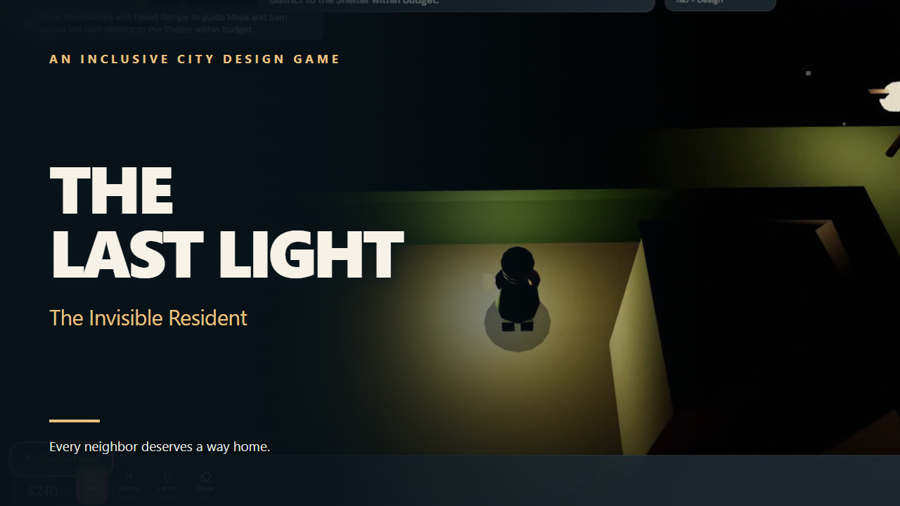
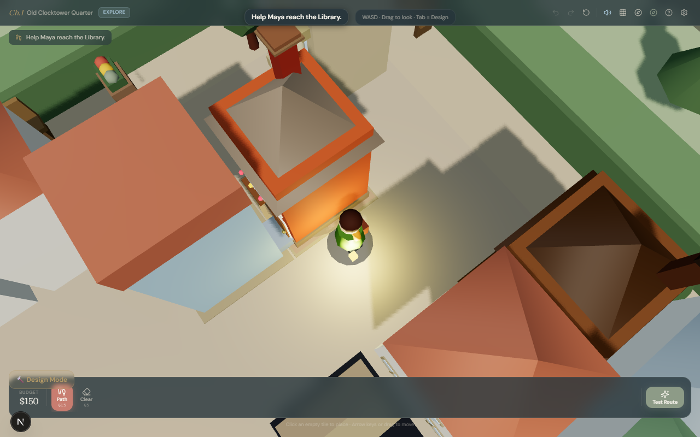
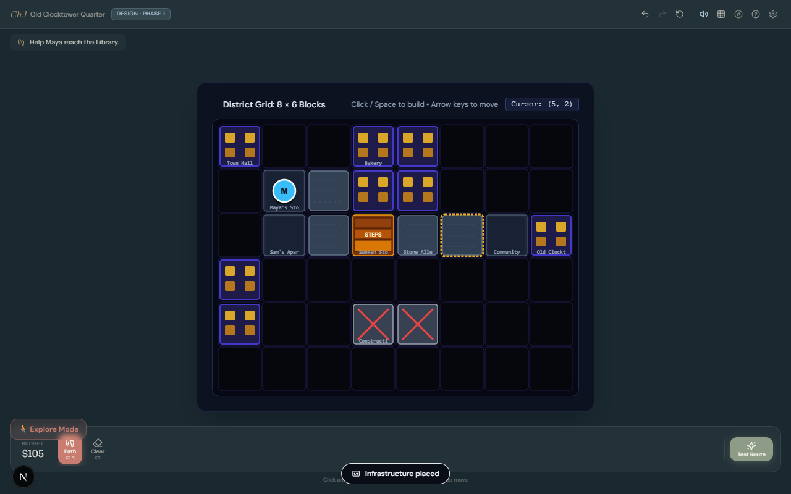
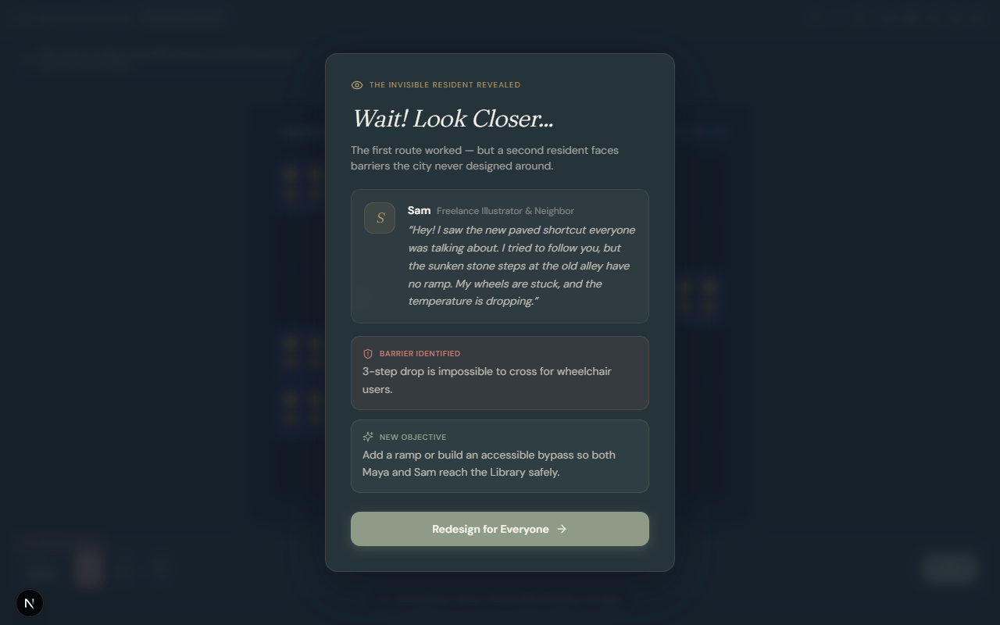
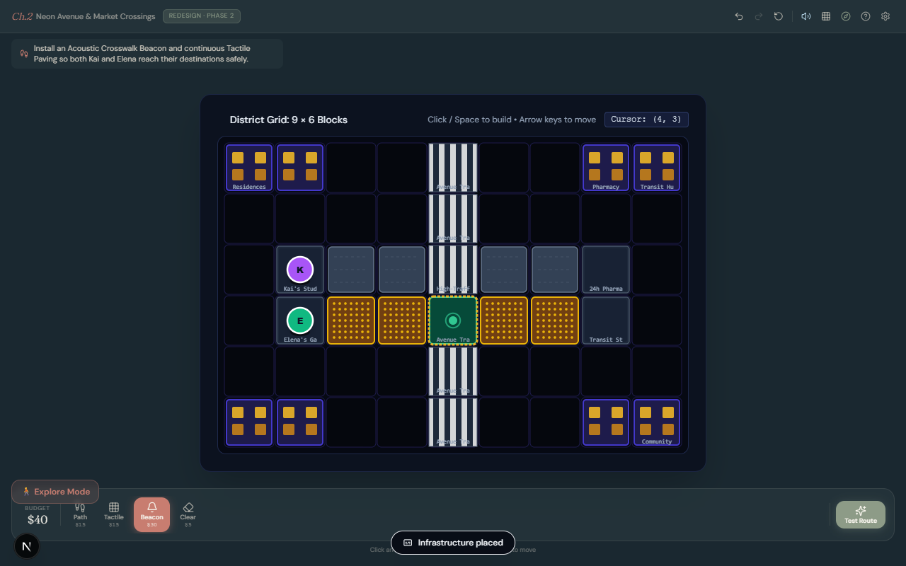
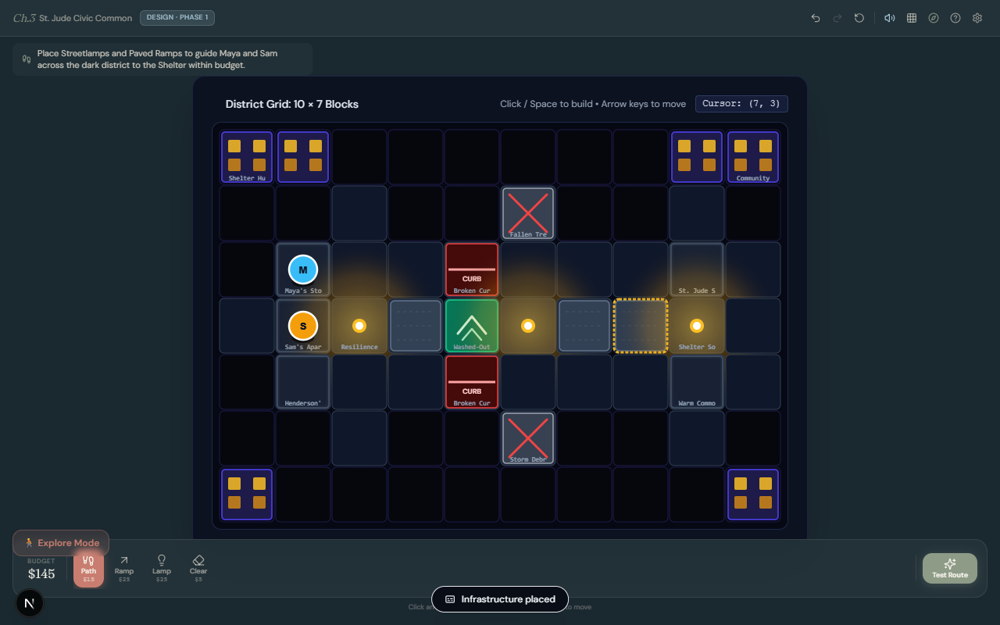
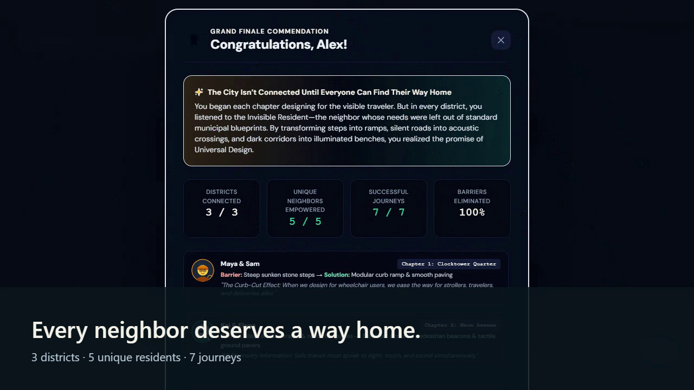
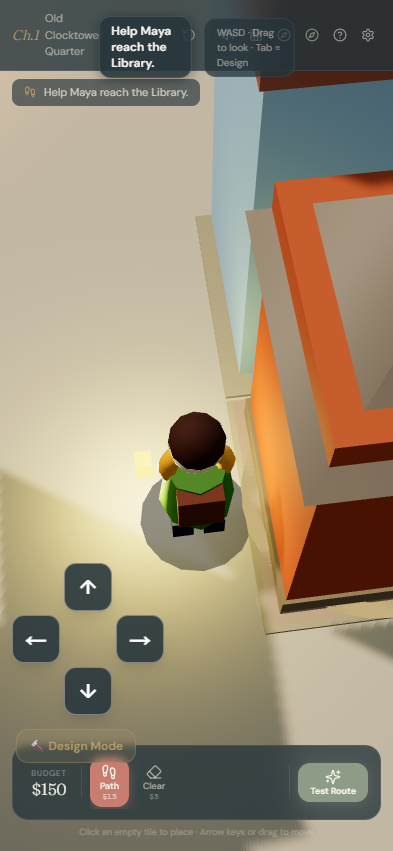

# THE LAST LIGHT — The Invisible Resident

> A city is not truly connected until everyone can find their way home.

An inclusive city-design puzzle made for the Girls Who Code HHS Hackathon 2026. Walk through three neighborhoods, improve routes within a budget, and test whether each resident can reach their destination. The first route that works may still leave a neighbor behind.



## See the game

All images below are captures from the running game.

| Explore as Maya | Build a shortcut |
| --- | --- |
|  |  |

| Discover Sam's barrier | Redesign the silent crossing |
| --- | --- |
|  |  |

| Light the blackout route | Finish all three chapters |
| --- | --- |
|  |  |

Mobile Explore Mode has on-screen movement controls:



## How to play

1. Enter your name, read the short introduction, and begin Chapter 1. A tutorial explains the basic loop. The **How to Play** control remains available during the game.
2. In **Explore Mode**, walk with **WASD** or the **arrow keys**. Hold **Shift** to jog, drag the mouse to change camera direction, and use **Reset Camera** when needed. On a touch screen, hold the directional pad; two directions can be held together.
3. Switch to **Design Mode** with **Tab** while the world or board has focus, or use the on-screen mode button. Select a tool, place improvements on the board, and watch the budget.
4. Select **Test Route** to watch a resident's journey. Read the result, including any failed route explanation. A newly revealed resident may need a different solution.
5. Make the route work for everyone in that chapter, then continue to the next district.

Movement stops when a blocking dialog opens, while entering text, and when leaving Explore Mode. Progress is saved locally in the browser; chapters can be replayed.

## The three chapters

| Chapter | Residents | Design challenge |
| --- | --- | --- |
| **The Shortcut** | Maya and Sam | Connect the Library and remove a stair barrier with an accessible route. |
| **The Silent Crossing** | Kai and Elena | Add tactile paving and an acoustic beacon to make the crossing usable. |
| **One Light Left** | Maya, Sam, and Mr Henderson | Improve a blackout route with light, access, and places to rest. |

The Grand Finale counts **5 unique residents** and **7 successful journeys** across **3 districts**. A resident appearing in more than one chapter counts once as a person and once per successful chapter journey.

## Run locally

Requirements: Node.js 18.18+ and npm. The release checks were run on Node.js 24.

```bash
npm install
npm run dev
```

Open [http://localhost:3005](http://localhost:3005). To test a production build:

```bash
npm run build
npm run start
```

## Verify

```bash
npm run typecheck
npm run lint
npm test -- --reporter=verbose
```

`npm run lint` currently runs TypeScript checking; there is no separate ESLint command. For browser tests, start one development server with `npm run dev -- --port 3007`, wait for its first compile, then run:

```bash
npx playwright test --config=playwright.dev.config.ts --reporter=list --workers=1
```

The final local release pass recorded **52 passing unit tests**, **15 passing development browser tests**, **2 passing desktop/mobile production smoke tests**, a successful production build, and a visible-UI playthrough of all three chapters. Browser tests use real keyboard and touch input; the development-only movement diagnostic reads position for assertions and is absent from production. The ten-minute production soak completed 107 gameplay cycles with no browser errors. Longer memory and independent novice-player studies remain useful follow-up work.

## Technology and accessibility

Next.js 15, React 19, TypeScript, React Three Fiber, Three.js, Zustand, Tailwind CSS, Vitest, and Playwright. The game combines a third-person neighborhood view with a keyboard-accessible design board. It includes a mobile movement pad, visible focus handling, high contrast and reduced motion settings, captions for sound cues, and route failure explanations. Automated checks do not replace testing with people who use assistive technology.

## AI-assisted development

This project used AI coding assistants substantially, including Claude Code and OpenAI Codex, for implementation, debugging, tests, review, and release preparation. Gameplay results and the demo were verified through real browser interaction without injecting winning state.
